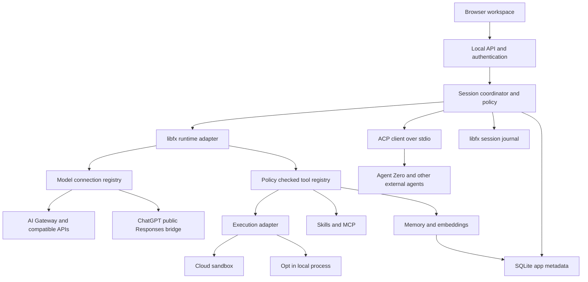

# A0 SLIM — revised build specification

**Revision 0.7 · 2026-10-26 · Local alpha; live acceptance gates remain**

Owner direction: a local-first app, public GitHub repository, flexible model and sandbox connections, useful access to the Agent Zero Plugin Hub, and a polished, minimal, customizable interface. The [preliminary spec](docs/original/A0-SLIM-SPEC.md) is preserved unchanged. The user approved the direction on 2026-10-26. This specification describes the target product; delivered behavior and open gates are recorded in [P0 verification](docs/verification/P0.md) [P1 verification](docs/verification/P1.md), and [P2 verification](docs/verification/P2.md).

## 1. Product and scope

A0 SLIM is an approachable local agent workspace for research, coding, file work, and repeatable tasks. A user chooses a project, selects a model and execution environment, asks for an outcome, and follows progress through an inspectable activity timeline and real artifacts. The agent can remember approved knowledge and delegate bounded tasks.

The product runs a Node service on the user's computer and serves its UI to a browser. Closing the tab does not stop active work. Stopping the service cancels owned native work; external ACP agents may continue remotely and require outcome review. Remote model services and cloud sandboxes are optional connections. Local-only work is possible when a suitable local model is configured. No local Docker installation is required for the core app.

The first release serves one trusted OS user with multiple projects. Multi-user hosting, billing, team tenancy, full Agent Zero feature parity, native desktop packaging, and an always-on remote worker are separate future projects. Browser/desktop/office automation may later arrive through adapters or an Agent Zero bridge; it is not falsely presented as impossible without Docker.

**Release promise:** useful work with visible execution boundaries, recoverable sessions, portable extensions, and a beautiful everyday interface. Installation size, startup latency, and memory use must be measured; “Slim” does not imply that optional AI weights or native dependencies are tiny.

## 2. Corrections to the preliminary design

| Preliminary assumption | Revised decision |
| --- | --- |
| “libfx v3+” | npm package is `0.0.14`; its API version is 3. Pin the package, not a nonexistent package major. |
| Node 20+ | Target Node 24 LTS. Node 20 is EOL. Verify packaged native/WASM support per platform. |
| Static prompt built once at startup | Cache immutable fragments; assemble a versioned, policy-filtered prompt snapshot per turn. |
| Every model fits the same custom provider | libfx's custom provider speaks Chat Completions. Other protocols require a tested bridge. |
| Codex provider equals recommended subscription flow | Current OpenAI documentation describes dynamic registration and public Responses. Verify integration separately from libfx's bundled Codex helper. |
| Removing Docker means running commands unsandboxed | Add execution adapters. Start with execution off or a configured sandbox; local host mode is a deliberate opt-in. |
| JSON vector file rewritten per change | Use transactional SQLite metadata/text/embeddings and a small in-process similarity search. |
| A `response` tool ends the engine loop | Use libfx's terminal result. A plain host tool has no documented `break_loop` field. |
| Two chat endpoints and a shared token are enough | Add bootstrap authentication, ownership checks, message deduplication, steering/cancel, approval and artifact APIs. |
| Browser disconnect ends work | Disconnection only detaches the viewer. Stop sends an explicit cancellation and waits for execution status. |
| Plugin Hub installation implies compatibility | Browse the real catalog; classify and verify compatibility before enabling installation. |

Evidence and links: [source audit](docs/research/SOURCE-AUDIT.md). These changes retain the original independent Node/libfx direction.

## 3. Architecture and ownership

Choose **Node 24 LTS + TypeScript**, **Fastify** for a single local API/static server, **React + Vite** for the client, and **SQLite** through a pinned supported binding. React supports complex streaming and settings states without a homegrown component framework. Vite is build-time tooling; users run one service, not a dev server. Keep a single repository/package until real ownership warrants splitting it.



Proposed ownership:

- `src/runtime/`: libfx construction, event normalization, session-to-agent mapping, provider protocol bridges; no UI dependencies.
- `src/acp/`: external-agent profiles, protocol negotiation, session mapping, permissions, events and recovery; independent of libfx and model providers.
- `src/providers/`: connection metadata, credentials references, catalog/capability probes, auth lifecycle. Secrets never enter browser state or prompts.
- `src/execution/`: sandbox adapters, job receipts, workspace transfer and artifact collection.
- `src/tools/`: small built-in tools calling owned services; registration is explicit and validated.
- `src/policy/`: permissions, approvals, capability filtering, budgets, resource limits.
- `src/memory/`: text records, embedding namespaces, retrieval, import/export/deletion.
- `src/extensions/`: skills, MCP, Slim manifests, Hub discovery and compatibility overlays.
- `src/storage/`: SQLite migrations, application metadata, operation receipts, backups.
- `src/server/`: local authentication and versioned API; `ui/`: workspace and settings.
- `prompts/`: original Slim instructions, profiles and protocol fragments; `tests/`: contract, integration and UI verification.

Keep libfx as the loop owner. Do not wrap it in another general agent framework. Add only the provider/execution/session coordination required by this product.

Use an OS-appropriate user data directory outside the source checkout by default; `A0_SLIM_DATA_DIR` may override it. Separate `sessions/`, `models/`, `artifacts/`, `backups/`, and the app database. Project folders are separately chosen. SQLite and the libfx journal have distinct owners; reconstruct derived UI state rather than writing a competing authoritative transcript.

## 4. Model connections and subscription access

### Independent registries

`ModelConnection`, `EmbeddingConnection`, and `ExecutionConnection` are separate records. A preset references each by ID; it does not copy secrets. A connection declares protocol, credential reference, endpoint, model catalog source, supported features, health state, and last verification time. Custom endpoints are user-configured administrator settings, never model-generated URLs.

| Connection | Planned route | Delivery |
| --- | --- | --- |
| Vercel AI Gateway | Native libfx gateway | P1 default cloud option; user can choose another. |
| ChatGPT subscription | Official Sign in with ChatGPT + public Responses integration | P0 proof; P1 release gate. |
| OpenAI API, OpenRouter, compatible providers | libfx custom Chat Completions provider | P1, per-model tool/stream tests. |
| Gemini API | Documented OpenAI-compatible endpoint | P1, validated subset. |
| Ollama / LM Studio | User's local compatible server | P1; verify selected model supports tools. |
| Anthropic API | Initially available through Gateway; direct Messages protocol bridge | Direct connection P2, explicit capability validation. |
| Hugging Face Inference Providers | Compatible hosted chat endpoint | P2; model and backend availability vary. |
| Grok subscription | libfx offers a helper; provider contract/access still needs validation | P2 opt-in experiment, not launch acceptance. |
| Additional subscriptions | Dedicated connector where vendor supports third-party use | No generic “paste your session cookie” mechanism. |

Never silently send a conversation to a different provider after failure. Fallback is configured by the user, displays the destination and billing route, and respects project data-sharing rules. A catalog lists possibilities; a completed request verifies current access. Show auth, capability, quota and outage errors separately.

### ChatGPT design and compatibility gate

The preferred new integration uses OpenAI's documented local OSS flow: stable host ID; first-time dynamic registration; state, nonce and PKCE; loopback callback; issued client ID associated with verified account/workspace; validated token identity and granted plan scope. Credentials are held by Slim, with refresh serialized per account. Do not reuse another application's rotating credential file. See [registration](https://developers.openai.com/siwc/token-sharing-open-source/sign-in).

The inference contract uses public `POST /v1/responses`, `store:false`, `stream:true`, account-aware model choices, and explicit completion handling. Unsupported parameters and tool types must be removed/rejected rather than guessed. See [inference](https://developers.openai.com/siwc/token-sharing-open-source/models-and-inference) and [preview limits](https://developers.openai.com/siwc/token-sharing-open-source/preview-limitations).

**Implemented bridge, bounded compatibility:** libfx 0.0.14's built-in `codex` helper uses a Codex-client flow, while its custom provider is Chat Completions. The alpha implements a narrow in-process protocol bridge through libfx's documented `fetch` seam. The bridge converts messages and function calls to the supported public Responses shape and maps streamed results back without losing call IDs, errors, cancellation or terminal status. It has an internal endpoint identity intercepted in-process, never a public proxy. Credentials attach only at the OpenAI fetch boundary.

Acceptance includes a two-step tool round trip, restart with history, account switch, token refresh, revocation and an error after streaming starts. If the bridge cannot preserve semantics, record the blocker and propose an upstream supported adapter or a separately scoped Codex app-server mode. Do not quietly replace libfx or ship a reverse-engineered endpoint as the approved path. Live ChatGPT text/function requests and an approved synthetic artifact have passed. Completed provider output, including encrypted reasoning and message phase, is retained in an encrypted account/chat/model-scoped journal before tool dispatch. Some live subscription streams carry completed items separately and leave the terminal output array empty; the bridge accepts those items only after terminal success. File-evidence notes inserted by libfx on restoration are retained separately as user context. JSON arguments are canonicalized for stable native replay. Changed or compacted history fails closed; automatic compaction and fork mapping are not implemented. Real reasoning-bearing output, refresh/revocation, quota behavior and additional models remain separate acceptance gates. See the verification records for restart evidence and limits.

Model selection in a new draft stays in the draft until first Send. Saving a preset or browsing model choices must not create a remote agent session. Freeze the effective configuration on accepted turns. Keep stable libfx agent identities per connection/profile revision; when switching providers, show the data transfer and fork into a new mapped runtime session with a deliberate context handoff. Same-provider model changes apply only to the next turn after capability checks. This avoids mutating one shared named agent's configuration underneath existing sessions.

## 5. Execution environments and adding services

The alpha offers **No code execution**, **Local Docker**, or **Vercel Sandbox · Node.js** for new native chats, plus synthetic connection checks for other cloud providers. The target also includes explicitly opted-in **Trusted local process** execution. Read-only chat/research remains usable without a sandbox account. A configured sandbox is the recommended environment for arbitrary code. Trusted local mode clearly states that commands have the host user's OS permissions; a working-directory check is not isolation.

The “Add environment” flow is: choose service → enter connection details → test connection → inspect supported capabilities → select region/template/network policy and limits → save → select per project. Following the owner’s free-option request, the alpha includes local Docker and Vercel Node.js execution plus synthetic check adapters for Vercel Sandbox, Modal, E2B and Daytona. Each cloud card provides official logos, signup/sign-in/dashboard links and guided credential setup. Provider website authentication is separate from the encrypted application credential. The target design allows users to add a compatible service by URL/API key through the versioned Slim Runner protocol; an arbitrary vendor API still requires an adapter. Advanced users can install a reviewed adapter package. No editing application source is needed for an existing adapter.

The alpha's local Docker runner pins its Node image by digest, permits only a local Unix-socket engine, and creates one disposable container per call. It uses no network, host mounts or credentials; drops capabilities; runs non-root; limits CPU, memory, process count, output and execution time; and verifies removal. Unknown cleanup blocks new work until exact-resource reconciliation. The project default is copied into each new chat and displayed as its effective environment.

**Vercel native execution (2026-10-26):** a passing connection test enables an explicit per-project cloud-use grant and the Vercel choice for new native chats. No local Docker engine is required or consulted. Chat execution and credential revision are frozen at creation. Every `run_javascript` call sends only the agent’s code and explicit input to one nonpersistent Node 22 sandbox: 1 vCPU, no published ports, denied egress, 60-second VM lifetime, a 10-second child process and 12-second provider command timeout. Code/input/output limits are 32/64/64 KiB; the child Node heap is capped at 128 MiB, not the VM’s total memory. Three calls per turn and ten per ten minutes across projects are counted from durable receipts. No automatic project upload, shell/PTY interface, package installation, persistence or model-key injection is provided. Local file application retains its separate reviewed-artifact workflow.

Creation and command intents are saved before dispatch. The Vercel SDK transport blocks duplicate mutation requests, automatic resume (including GET with `resume=true`) and automatic log recovery; transport responses and output are bounded. Same-call or identical-input requests within a turn reuse the existing receipt, including after restart. Synthetic checks, execution, credential changes and recovery share a provider lease. Cleanup runs independently of cancellation using the original scope and exact name/tags; unknown compute outcomes block new sandboxes. A confirmed stop with failed deletion remains visible as stopped with a cleanup error and can be retried without running code. Revocation blocks future dispatch; changing credentials requires a new passing test, grant and chat. Read-only subordinates and ACP sessions cannot acquire this native tool. [Setup and acceptance](docs/VERCEL.md) distinguish offline fixture evidence from live execution acceptance.

**SPACE connection preview (2026-10-26):** the dedicated native HTTP/SSE adapter and setup/status/recovery UI are implemented for the SPACE 0.8.x public M1 API, with a pinned 0.8.0 fixture baseline. The documented server requires Linux x86_64/KVM; SLIM on macOS connects to a separately provisioned deployment. Store management/data-plane/console origins, API prefix, template, requested resources and encrypted token separately from other providers. Read-only connection checks verify the deployed schema, authenticated account, organization, cluster and sandbox listing. Synthetic execution requires explicit compute and cleanup acknowledgments. Creation, command and deletion intents persist exact requests and idempotency keys before dispatch. Attachment starts execution, carries only the session token to the validated data-plane destination, and must yield bounded complete output plus a successful terminal process event. Deletion requires a successful matching operation. Recovery never creates a sandbox or command, follows the original endpoints and verified principal, allows same-principal token renewal, and reuses a lost delete request only within 24 hours. A 404, empty listing or restart never clears an unknown hold. An explicit absence review is separately recorded after 24 hours with verified account continuity, a complete listing and terminal known creation operations; it does not claim deletion or passing execution. Official Perplexity artwork and deployment-specific console links identify the provider. No server was provisioned and live acceptance is pending. SPACE has no asserted hard sandbox TTL or enforced egress policy in this delivery, and general agent execution is disabled. See [setup and recovery](docs/SPACE.md) and [source assessment](docs/research/SPACE.md).

The Vercel, Modal, E2B and Daytona cloud check adapters persist identity and scope before creation, keep project data local, and enforce a 60-second sandbox TTL. SPACE has the separate lifecycle boundaries described above. Vercel reconciles stop/deletion; Modal reconciles termination; E2B and Daytona verify deletion by resource ID. E2B uses a kill timeout with auto-resume disabled; Daytona uses a one-minute wall-clock TTL and automatic deletion. A Modal app/base-image cache can remain after stopped compute. A timed-out creation stays unknown even if the SDK later completes it; recovery uses the original name and ownership tags. Broader cloud execution and the general Runner protocol below remain target work; bounded native Vercel Node.js execution is implemented as described below.

| Option | Free-use model, checked 2026-10-26 | Alpha capability |
| --- | --- | --- |
| Local Docker | No cloud compute fee; local engine/resources required | Agent Node.js execution, real local checks passed |
| Vercel Hobby | 5 CPU hours, 420 GB-hours, 5,000 creations monthly; quota pauses | Native Node.js execution; live lifecycle and one native chat calculation passed with deletion verified |
| Modal Starter | $30 monthly compute credit; additional usage may be billed | Configurable synthetic check; live account pending |
| E2B Hobby | $100 one-time usage credit; no card required to start | Configurable synthetic check; live account pending |
| Daytona | $200 introductory compute; usage pricing afterward | Configurable synthetic check; US region; live account pending |
| SPACE | Self-hosted; hosting and compute supplied by the owner | Native setup/status/synthetic checks; 0.8.0 fixtures passed, live server pending |

```typescript
// Proposed Slim contract, not an existing vendor API.
interface ExecutionAdapter {
  id: string;
  capabilities: ExecutionCapabilities;
  testConnection(signal: AbortSignal): Promise<ConnectionReport>;
  create(spec: SandboxSpec, operationId: string): Promise<EnvironmentRef>;
  inspect(ref: EnvironmentRef): Promise<EnvironmentState>;
  execute(ref: EnvironmentRef, job: JobSpec): AsyncIterable<JobEvent>;
  cancel(ref: EnvironmentRef, jobId: string): Promise<CancelReceipt>;
  upload(ref: EnvironmentRef, files: WorkspaceManifest): Promise<TransferReceipt>;
  download(ref: EnvironmentRef, paths: string[]): Promise<ArtifactManifest>;
  stop(ref: EnvironmentRef): Promise<StopReceipt>;
  destroy(ref: EnvironmentRef): Promise<void>;
}
```

Optional capabilities include pause/resume, snapshots, PTY, network allowlists, persistent disks and resource telemetry. Advertise only features the service actually supports. Unsupported policy requirements fail before creating an environment. Vercel snapshot behavior and E2B pause semantics differ; the UI must not call both “Save” without explaining the result. Pin the chosen SDK/API generation; Daytona's stable and alpha docs describe different lifecycle contracts.

Each job carries an operation ID, environment ID, working directory, timeout, output cap and cancellation signal. Persist creation and command receipts; on timeout or host restart, reconcile with the provider before repeating a potentially mutating operation. `unknown` is a real outcome. No automatic fallback from a failed remote sandbox to unrestricted local execution.

Transfer only selected project paths with a displayed upload manifest; exclude credentials and private app data. Collect output into quarantined artifact staging, validate paths/size, preview diffs, then apply approved changes to the local workspace. Remote sandbox isolation does not protect data intentionally uploaded to it. The sandbox receives no model keys by default; any command-specific secret grant is scoped and redacted.

Start with conservative, editable limits: 10-minute job timeout, 1 MiB retained inline output, 100 MiB transfer allowance, one active environment per project. Treat these as product defaults, not vendor quotas. Show TTL, status and estimated/actual resource usage when available; never fabricate a dollar figure for a subscription or unavailable sandbox cost.

## 6. Tools, policy and prompt construction

Expose only enabled tools that the current project, model and execution environment can actually use. Generate the tool catalog from the same registry that dispatches calls. Validate names and JSON schemas at startup. Tool outputs, web pages, repository text, memory and plugin metadata are untrusted content, not permission to change policy.

| Tool | Replay classification | Design |
| --- | --- | --- |
| `read_file`, `list_dir` | `idempotent:true`, `writes:false` | Authorized project root, bounded output, safe path handling. |
| `write_file` | `true,true` for staging only | Immutable, deduplicated proposal; exact browser approval performs atomic application. Unknown outcomes block new proposals until reconciliation. |
| `apply_patch` | Planned | Must use the same reviewed-operation boundary. |
| `run_javascript` | `true,true` with owned receipt | Disposable Docker or Vercel Node.js computation; owned receipts suppress repeat calls, unknown cleanup blocks further creation. Vercel also deduplicates identical code/input within an owning turn and requires a current project cloud-use grant. |
| `code_execution` | `false,true` | Execution adapter only; shell semantics explicit; no automatic retry of unknown effects. |
| `web_search` | `true,false` for ordinary lookup | Configured search connector; citations returned as data. Gateway provider search is capability-specific. |
| `memory_save`, `memory_delete` | `true,true` only with atomic operation-key deduplication | Transaction includes mutation and receipt; otherwise classify non-idempotent. |
| `memory_load` | `true,false` | Project isolation and provenance filters. |
| `call_subordinate` | `true,false` with durable parent-call/child mapping | Bounded read-only children; repeated IDs reuse results, interrupted children require explicit continuation. Two active assignments may run; no permission expansion. |
| `wait`, `notify_user` | Explicit bounded semantics | Local UI events only; external messaging is a separate permissioned extension. |

`writes` controls libfx scheduling; it does not grant OS permissions. `idempotent` is a recovery promise, not a synonym for “read-only.” A SIGKILL proof against libfx 0.0.14 showed that an ambiguous non-idempotent call becomes an error result, after which the model can issue another call. Slim must block effectful tools until unknown operations are reconciled; an error message to the model is insufficient. The foundation therefore exposes only read-only file tools. Built-in serialization does not prevent conflicts between separate sessions; Slim owns project/resource locks and file revision checks. The source package documents native parallel calls and different WASM scheduling. See [libfx tools](https://fx.sh/docs/lib/tools).

Return the final answer through the engine's terminal event, not a fictitious tool return flag. Preserve the familiar Agent Zero tool vocabulary where useful, but write Slim-specific prompts for native structured tool calls. Assemble role → project/profile → capabilities/tool catalog → activated skill summaries → response/safety protocol. Freeze fragment hashes, plugin versions and the effective policy on each accepted turn; refresh on the next turn when settings change.

Subordinates inherit a subset of tools, the remaining parent budget, the same project boundary and cancellation tree. The preview allows maximum depth 2, two active assignments and six calls per root turn, eight model requests per assignment, two minutes or the parent’s remaining time, and a 16,000-character result. Requests share the persisted project/model/connection budget; these limits are not a guaranteed token or dollar ceiling. Store parent-call-to-child-session mapping before starting work. After interruption, reconnect to that child rather than spawning another. Never pass arbitrary entire parent history or credentials by default.

Stop must abort pending child submissions as well as active turns and wait for descendants before reporting completion. Explicit continuation of an interrupted child first closes its old turn with model transport blocked. Confirm the exact old message's terminal event within the remaining assignment deadline and a 40-second recovery allowance, accommodating libfx 0.0.14's 30-second local stale-lock interval. Missing terminal evidence preserves the interrupted receipt and blocks replacement children.

## 7. Local memory and Hugging Face

Memory is optional and inspectable. Save deliberate user requests and useful, attributable task results; do not silently turn every conversation into permanent memory. Project-specific storage is the default, with explicitly shared notes available across chosen projects. Keep `main`, `fragments` and `solutions` as familiar area labels, without promising byte compatibility with Agent Zero FAISS indexes.

SQLite stores IDs, project scope, text, source references, created/updated timestamps, area, tombstone/deletion status, schema version and operation receipts. Store embeddings separately with a fingerprint of provider, model/revision, dimension, normalization and preprocessing. Mixing incompatible vectors is forbidden. Changing embedding models starts a resumable reindex into a new namespace and switches atomically after validation; lexical retrieval remains available during migration.

Start with FTS lexical retrieval plus brute-force cosine ranking for small corpora, combined by rank fusion. Expose relevance scores as ranking aids rather than calibrated probabilities. Benchmark 10,000 records on documented hardware before selecting an approximate index. A vector database service is unnecessary for this initial scale.

| Embedding mode | Benefits | Requirements |
| --- | --- | --- |
| Local Node + Transformers.js | On-device embeddings; durable disk cache | Explicit model download, pinned revision/checksum, license/size display, worker thread. Recommended optional local mode. |
| Browser worker + Transformers.js | Private browser-side ingestion/experiments | WASM/WebGPU detection, quota/eviction handling, re-download recovery. P2 experiment, not the server's durable memory owner. |
| Gateway/OpenAI/compatible embedding API | Small local installation | Separate key/account and data-sharing choice; batching and rate limits. |
| Hugging Face hosted inference | Additional hosted embedding choices | Verify feature-extraction output/pooling and model availability. Hosted inference is distinct from downloading weights. |

Hugging Face supplies model artifacts; local execution requires an appropriate runtime and format. Transformers.js can load ONNX models and local files. GGUF chat models belong to compatible runtimes such as Ollama/llama.cpp/LM Studio, not automatically to Transformers.js. [Custom model loading](https://huggingface.co/docs/transformers.js/custom_usage).

The model manager must support progress, cancel/resume where supported, storage location, disk estimate, offline-ready verification, and delete. Do not download weights on first launch without a user action. Bundle/pin required WASM assets for a real offline mode; a cached model alone is insufficient if runtime assets still come from a CDN. Browser caches can be evicted, and browser closure cannot own background recall.

Deletion removes active text, vectors and derived search entries; tell the user what retained backups contain and provide backup deletion. Export memory with provenance and schema version; import text independently from incompatible embeddings. Memory retrieval never grants permission to run a tool.

## 8. Plugin Hub, skills and MCP

The real Agent Zero community index is discovery metadata pointing to separate plugin repositories. The current app consumes the generated release JSON at `https://github.com/agent0ai/a0-plugins/releases/download/generated-index/index.json`; individual upstream `index.yaml` files are not a single root catalog. Current plugins may contain Python hooks, framework imports, Alpine UI fragments and OS dependencies. This is not a Node package registry. Use a read-only Hub catalog and an independent Slim compatibility overlay; do not invent supported fields in upstream `index.yaml`. [Upstream index](https://github.com/agent0ai/a0-plugins).

Show **Works with Slim**, **Requires Agent Zero**, **Port available**, or **Compatibility unknown**, with a reason and last verified revision. A familiar name or valid manifest is not sufficient evidence. Preserve the last good catalog on fetch failure, show its age, allow explicit refresh, and prevent an older request from overwriting newer results.

Four extension routes:

1. **Skills:** Markdown instructions and opt-in resources. Scripts still run through the selected execution adapter. Skill loading does not bypass permissions.
2. **MCP tools:** supported through libfx's adapter, with configured transports, server identity, authentication, timeouts and health. Treat remote annotations as hints; writes are conservative by default. A local stdio server is executable host code, so starting it is an installation capability, not just loading metadata.
3. **Slim extensions:** versioned `a0-slim.plugin.json` with ID, version, runtime API range, entry point, settings schema, contributions and permissions. Contributions initially include providers, embedding backends, execution adapters, tools, skills and theme tokens. Trusted built-in adapters may run in-process; third-party executable extensions need an isolated runner or an explicit full-trust installation choice. A Node worker process alone is not a security sandbox.
4. **External agents over ACP:** use the generic ACP client for a whole Agent Zero conversation and its existing runtime behavior. Keep the Agent Zero MCP preset for individual tools in native SLIM chats. Python plugin behavior and memory stay in Agent Zero; neither protocol makes its WebUI fragments or arbitrary API handlers native SLIM components. Assess each plugin and agent separately.

Install flow: source and revision → compatibility → permissions and dependency summary → download/validate → stage → explicit enable → health check → rollback on failure. No executing installation hooks while browsing. Updates pin a resolved revision, show new permissions, and retain the previous working version. Disable/uninstall cancels owned work and offers keep/delete plugin-owned data. Unknown/incompatible plugins offer “View source” or bridge guidance instead of a misleading Install button.

Avoid arbitrary UI JavaScript injection into the main origin. Start with declarative settings and theme contributions. Rich third-party screens later need a separate-origin/sandboxed surface and narrow message protocol. MCP Apps/Generative UI compatibility is not implied by basic MCP tool support.

### 8.1 ACP agent connections — approved 2026-10-26

Keep the native Node/libfx runtime and MCP support. Add a separate external-agent backend using the official `@agentclientprotocol/sdk@2.0.2` stable ACP v1 interface over stdio. The draft selector chooses a native model connection or an ACP agent; the first Send freezes the backend and profile for that chat. Existing chats retain their runtime identities. Do not wrap an ACP agent as a model provider or silently migrate native conversations.

Agent Zero is the first preset: an explicitly selected, installed `a0` executable, `acp [--host <instance-url>] --transport connector`, and the CLI's own sign-in. Generic profiles accept an absolute executable and an argument array, never a shell command. Profiles are immutable; disable/re-enable or save a replacement. No automatic installation, agent downloads, API-key forwarding, MCP-server forwarding, shared memory or Python-plugin installation. ACP starts a trusted process with OS-user authority. In the inspected Agent Zero connector, host read/write and execution are governed by Agent Zero settings rather than ACP client capabilities; disclose this before enabling it.

Initialize with the supported protocol version and declared client capabilities. Check connection performs only initialization, closes the connector, and reports the agent/version; it is not proof of authentication, inference or plugin compatibility. First Send creates a session with the selected canonical project root. Reconnection loads the exact saved session only when supported; never replace an unloadable session automatically. Saved local activity can be viewed without starting an agent. Suppress load-history replay already represented in the local transcript; remote changes made outside SLIM are not synchronized in this preview.

Deliver text/Markdown streaming, tool activity, plans, pending one-time permission decisions, Stop and persisted cursor replay. SLIM can optionally serve bounded project text-file reads using its existing sensitive-path/symlink checks. File-write and terminal callbacks are not advertised or implemented. Missing capabilities do not constrain tools an external agent runs independently. Grant only an offered one-time permission for the exact pending request; discard pending approvals on Stop or disconnect. Persistent grants, attachments, remote HTTP ACP, interactive ACP authentication, model/mode configuration and delegated ACP subagents are deferred.

Persist prompt intent and message hash before dispatch. Duplicate IDs do not resend. A process crash, lost connection or unconfirmed Stop after dispatch leaves an unknown outcome; all new ACP tasks are held, including through duplicate profiles, until the user records an external outcome review. Never automatically retry a prompt. Stop sends `session/cancel`, cancels permission requests and waits for the prompt's terminal response. Killing the local connector does not prove remote work stopped. Do not send `session/close` as generic cleanup: Agent Zero's implementation removes the remote chat.

Bound connection startup, session setup, turns (10 minutes), incoming frames (1 MiB), retained update volume per turn (2 MiB or 10,000 updates), concurrent connectors (8), and pending permission requests (32). These client limits are not token/cost limits on external agents. Native provider budgets, tool approvals, MCP permissions and memory grants remain native-runtime boundaries. Verify transport, cancellation, permission, path, replay, duplicate-ID and recovery behavior using an independent synthetic stdio peer. Record installed Agent Zero handshake separately from an owner-authorized live task and second-agent acceptance.

## 9. Sessions, streaming and local access

Use `createFxAgent` for durable sessions and `createFxEngine` only for bounded experiments/tests. Pin `libfx@0.0.14` and lock transitive dependencies. Persist with explicit `local({dir})`; do not accept libfx's temporary-directory default. Respect SDK-generated session IDs rather than constructing arbitrary IDs. Maintain the application chat ID → runtime session mapping in SQLite.

A user message has a stable client-generated `messageId`. Retry submits the same ID, and an accepted input remains accepted even if the HTTP stream breaks. The canonical UI stream uses `session.stream(cursor)`; persist the last *applied* cursor. Avoid independently rendering both a prompt stream and a replay stream as authoritative copies. Normalize NDJSON into a versioned Slim event envelope with session/turn/tool IDs, cursor and timestamps. Do not parse provider raw events in UI components.

Required API families under `/api/v1`:

- bootstrap/login/logout and server status;
- project/chat creation, listing, metadata and archive;
- messages, event stream, steer and cancel;
- durable approvals with action hash and policy revision;
- files, artifact manifests, diff/apply and download;
- connections, auth lifecycle, model catalogs and health;
- memory, model downloads, extensions and appearance settings.

Only the coordinator opens authorized runtime sessions. Every read, stream, prompt, steering, cancel, file and artifact request checks the caller's access. Loopback binding, strict Host/Origin checks and CSRF protections are required; an unrelated website must not command the local service. Use a one-time pairing code displayed by the launcher, exchanged for an HttpOnly SameSite session cookie, not a permanent token in localStorage or URL history. API clients may use a separate scoped token. Production remote exposure is off by default and not supported in the initial release.

Stream errors distinguish rejected input, interrupted viewer, failed model, pending approval, lost execution status and cancelled run. A stop request is visible immediately, but the UI reports completion only after children and commands stop or their unresolved status is shown. Service shutdown stops accepting work, flushes journals and attempts cleanup; restart reconciles environment receipts and interrupted turns.

## 10. Workspace experience and visual direction

**Direction: a functional Agent Zero workspace.** Graphite surfaces, warm neutral text, restrained green/teal accents, thin dividers and purposeful typography. Use original Agent Zero symbols from `docs/res/a0-vector-graphics/`, copied unchanged with attribution; pair them with the A0 SLIM name. Do not invent a replacement logo or imply upstream endorsement.

The primary screen is the workspace, not a marketing landing page: collapsible project/chat navigation on the left, conversation and composer in the center, optional inspector for Activity / Files / Memory on the right. Use generous reading space without wasting operational space. Use plain page titles and descriptive controls; do not use eyebrow labels or slogan-style copy. Activity appears as compact meaningful steps; expand raw logs on demand. Outputs have previews, provenance and download/apply actions.

The composer includes model and execution selectors plus attachment and Send/Stop controls. Persistent status makes the active environment visible. The user should never need to open Settings to know where a command will run. A command palette helps keyboard users navigate without adding toolbar clutter.

Appearance controls: System/Graphite/Paper, approved accent choices, comfortable/compact density, text scale, content width, inspector visibility and reduced motion. Store preferences separately from chat data; export/import a validated theme JSON. Custom CSS and executable theme scripts are out of scope initially. Enforce readable contrast rather than allowing unusable color combinations.

Responsive behavior: at wide widths show three panes; collapse the inspector below roughly 1100 px; at narrow widths use drawers and a full-width conversation. Test 1440×900, 1024×768 and 390×844. Keyboard focus, screen-reader labels, 44 px touch targets where practical, visible focus, AA contrast and reduced-motion support are acceptance criteria. Motion is brief and explains progress or pane changes; no decorative perpetual animation.

| State | Visible feedback | Next action |
| --- | --- | --- |
| Empty | Useful starting prompt, chosen model/environment | Create/open project or start chat. |
| Loading | Stable layout, truthful stage, cancel where possible | Wait, stop or inspect progress. |
| Permission | Exact action, destination, files and scope | Allow once, narrowly allow for session, deny. |
| Partial | Available output plus missing/failed portion | Retry only the safe unfinished part. |
| Error | Specific cause and retained draft/output | Reconnect, reauthenticate, change configuration or inspect. |
| Success | Actual artifact/result and location | Preview, apply, download or continue. |
| Recovery | Interrupted tool and known/unknown effect | Inspect external status before retrying. |

The accompanying [interactive preview](docs/review/index.html) uses fictional project content. Its theme, density, navigation and inspection controls demonstrate design intent; its providers and task results are not connected runtime features.

## 11. Security, reliability and distribution

Store API/OAuth credentials using the OS credential store where available; use an explicitly configured encrypted vault otherwise. Keep encryption keys outside the vault. Do not silently downgrade to plaintext if secure storage is unavailable. Restrict data-directory permissions; redact tokens and sensitive tool values in diagnostics. Local session files and SQLite content are not claimed to be encrypted at rest unless implemented; OS disk protection remains relevant.

Constrain direct file tools by canonical root, symlink rules, parent checks for creation, resource limits and expected file revisions. Test symlink escapes and replacement races. These checks guard file tools, not arbitrary host shell code. Sandbox/provider URLs reject embedded credentials and unsafe redirects; configured local endpoints are explicitly distinguished from public endpoints to avoid accidental SSRF. Sanitize rendered Markdown and never execute generated HTML in the application's privileged origin.

Persist approvals bound to an immutable action digest, session/turn, destination and permission scope. A changed action needs a new authorization. A restarted process must not reuse an approval for a different command. Limit total model turns, wall time, child fan-out and sandbox resource use. Show the source of any stop limit.

Microsandbox 0.7.11 is an optional local execution adapter, installed explicitly with a separately shrinkwrapped native SDK and digest-pinned Node image. Keep its native dependency tree out of the core npm graph. Separate installation, read-only runtime checking, synthetic VM execution and project selection. One local microVM per code call has no guest network, host mounts or model credentials; enforce bounded input/output, five-second code execution, a 60-second VM lifetime and three calls per turn. Persist create intent and stable identity before command authorization. Bind cleanup to the original host/runtime/receipt, verify deletion, and preserve unknown-outcome holds across restarts. Never replay uncertain commands or infer deletion from timeout. Short private runtime storage avoids macOS socket-path limits. Apple Silicon local acceptance is recorded in `docs/MICROSANDBOX.md`; Linux remains an acceptance gate. Native SLIM, ACP and MCP remain separate capabilities.

Distribute an npm CLI that serves a prebuilt UI and prints the actual loopback URL. The core includes compiled server/UI assets, dependency licenses and a production file allowlist. React, icon and Markdown packages are build-only dependencies; the browser retains their bundled functionality. Publishable shrinkwrap files pin both the core graph and the separately installed embedding recipe. No install-time downloads of model weights or ML runtimes. First support macOS arm64 and Linux x64; gate Windows and other architectures on real libfx backend smoke tests, particularly WASM/JSPI behavior. No claim of full portability from a TypeScript build alone.

Local embedding inference is an explicit add-on: install pinned Transformers.js/ONNX Runtime in private app storage with scripts disabled, then verify the native CPU binding in a cancellable subprocess before activation. Stage installs separately; preserve interrupted state after restart and require an explicit retry. Model downloads remain a separate choice with pinned checksums. Runtime removal stops local work but preserves weights, notes, vectors and namespaces; retrieval falls back to lexical search. Reinstallation restores the existing local index without silently downloading model weights. PyTorch/Python are not required. See `docs/PACKAGING.md` for measured package sizes and acceptance evidence.

Use backup-before-migration for user data, versioned schema migrations and a documented downgrade boundary for libfx journals. Keep export/import usable without the original model service. Telemetry is off by default; opt-in diagnostics show exactly what will be exported. No cloud deployment, vendor signup, paid resource or public package publication is authorized merely by approving this spec.

## 12. Delivery gates and validation

### P0 — prove the foundations before building breadth

- Verify native libfx startup on Node 24 on the chosen platform, custom provider tool-call semantics, generated IDs and durable local restart. Add focused test fixtures for every assumption used by the adapter.
- Prove the preferred ChatGPT flow and public Responses bridge with a user-authorized real account. Require terminal success, not an open authorization page. Synthetic tests are separate evidence.
- Prove Vercel Sandbox lifecycle, timeout, command receipt, artifact round trip and cleanup against a configured account; retain an adapter contract fixture for offline CI.
- Decide SQLite binding and keychain support from installation tests; record package pins and platform requirements. Retain existing logo provenance.
- Stop the affected feature if a critical API assumption fails; revise the decision rather than silently changing the product architecture.

### P1 — usable local alpha

Deliver first-run connection setup, projects/chats, Gateway/compatible models, the validated ChatGPT route, one sandbox adapter, safe built-in tools, draft model selection, streaming/replay, stop/steer, file/artifact workflow, approvals and appearance. The app must be useful without semantic memory or third-party plugins.

Acceptance: one end-to-end task generates an artifact; the UI reconnects without duplicate messages; an interrupted mutation is reconciled; the model/environment are always apparent; auth/CSRF and project-file escape tests pass. Capture rendered evidence at all target sizes.

### P2 — extensibility and memory beta

**Delivered P2 preview (2026-10-26):** native skill loading; turn-scoped capability snapshots; opt-in automatic lexical recall and atomic memory tools; MCP Streamable HTTP and full-trust stdio discovery with tool grants and exact-call approval/recovery; an Agent Zero MCP bridge preset with encrypted token custody; real Hub discovery and pinned source assessment; SQLite/FTS5 project memory; local pinned MiniLM downloads and isolated CPU inference; separate compatible embedding connections; resumable reindexing and hybrid retrieval; bounded read-only subordinates with separate persisted contexts, inherited capability ceilings and cancellation/recovery. See the delivery record for evidence. The bridge still needs an owner-run instance check, and this does not close all P2 acceptance gates.

The real Vercel synthetic sandbox check subsequently passed with artifact bytes, stop and deletion verified. Team slugs resolve through authenticated project metadata, public connection IDs persist in setup, and explicit provider-review reconciliation handles an absent earlier resource without erasing its failed receipt. The chat header now identifies its execution setting, and provider cards separate last connection-check evidence from current sandbox activity/unknown cleanup. Markdown assistant replies render bold, code, lists and GFM tables, including saved transcripts; raw HTML is disabled and remote images require a click. Broader cloud execution and second-provider conformance remain open. Bounded native Vercel Node.js execution was subsequently added; see the execution section and its separate live acceptance record.

Current preview boundaries: text-only skill import, one revision of rollback, manual MCP approvals followed by a new user message, no MCP OAuth/Apps, no native plugin installation, no shared memory, no document ingestion, no browser embedding worker. Subordinates are read-only research/review agents; profile/model overrides and child writes, MCP or execution are not delivered. New chats use the P2 runtime identity; existing chats keep their original tool set. Downloads resume completed checksum-verified files, not partial byte ranges. Hosted model revision labels partition indexes but cannot guarantee provider-side weight immutability. Optional inference libraries now install separately through Memory; neither source setup nor core CLI installation includes them.

Deliver SQLite memory with lexical and optional local embeddings, model download management, bounded subordinates, MCP/skills, compatibility-aware Plugin Hub, and validated cloud agent execution on the existing sandbox adapters. Deliver the generic ACP client starting with Agent Zero; retain optional MCP tool connections. Gate real-agent compatibility and direct Anthropic support on separate acceptance evidence.

Acceptance: the same execution conformance suite passes for two services; reindexing never mixes vector spaces; a plugin can be disabled/rolled back without orphaned jobs; unknown Python plugins are never installed as native Node extensions. Prove one real compatible extension and one deliberately incompatible entry. Browser embeddings are experimental until eviction/offline tests pass.

### P3 — public release

Ship installation/update/uninstall docs, configuration examples without secrets, provenance/notices, migration/backup guides, troubleshooting, security-reporting process and a versioned changelog. Run focused unit/contract tests, integration tests for touched boundaries, then the release end-to-end suite. Publish only after the user authorizes the release action.

Critical verification cases: duplicate message ID; UTF-8/NDJSON chunk boundaries; stale cursor; interrupted tool; unknown remote effect; crash during memory write; embedding model mismatch; child cancellation; token refresh concurrency; post-stream quota error; malicious Markdown; unauthorized stream/cancel; symlink escape; Hub stale-response race; plugin uninstall cleanup; secret-free export.

Performance targets, to be measured on named hardware: warm UI interactive within 2 seconds, ordinary local API p95 below 100 ms excluding model/disk-heavy work, transcript scrolling responsive with 1,000 messages, and retrieval p95 below 150 ms for 10,000 records excluding embedding generation. Targets are acceptance budgets, not measured results. Keep optional ML loading off the server event loop.

## 13. Review decision

Approval selects this local-first architecture, the visual direction, and the staged validation plan. It authorizes beginning P0 and then implementation within the validated scope. External account login, paid infrastructure, a change to a fundamentally different runtime, and public package release remain explicit actions when concretely ready.

Open technical gates are ChatGPT/libfx protocol compatibility, actual sandbox account capabilities, cross-platform packaging and per-plugin compatibility. They are intentionally visible; none has been passed by writing this document.
