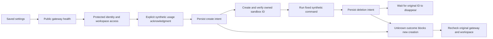

# OpenShell gateway integration

Implementation is authorized by the user's request. This canvas is open for feedback while work proceeds.

## Deliverable

A separate OpenShell gateway adapter in Environments, with explicit setup, encrypted credentials, read-only connection checks, one bounded synthetic execution check, and durable cleanup receipts. Native SLIM, ACP, and MCP keep their existing paths. OpenShell chat execution remains unavailable until its separate execution contract and live acceptance are validated.

## Connection and setup

- Target NVIDIA OpenShell SDK and gateway **0.1.6**, pinned to upstream tag `v0.1.6` (`ac7f615cd12d5cc49cb16eb1f5f10ffeb1e90f47`).
- Keep the SDK optional. NVIDIA currently distributes it through GitHub Packages; the public npm registry returns 404. Explain the authenticated installation without collecting a GitHub token in SLIM.
- Accept an explicit gateway origin, workspace, sandbox image, and either mTLS credentials or an OIDC bearer token. Use TLS verification, no implicit CLI credential discovery, and no model-provider credential export.
- Constructing the client establishes no connection. Report gateway health, authenticated identity, workspace access, and synthetic execution separately, with timestamps and changed/stale states.

## Recovery

- Persist intent before side effects, scope receipts to the gateway/workspace/identity, and keep unknown outcomes across restart or connection edits.
- Never replay the synthetic command. Never treat a timeout, failed lookup, or public health response as cleanup.
- Verify name, ID and ownership labels before deletion; use `waitDeleted` with the original `expectedSandboxId` afterward. Refuse a known replacement. The 0.1.6 delete RPC targets a name, without an atomic expected-ID precondition: document that remaining concurrent-replacement limitation and require a dedicated workspace for checks.
- Keep lost-create absence unresolved until an explicit operator review. A lost deletion is rechecked without silently submitting another destructive request.

## Verification and delivery

Test lazy connection, health/auth distinctions, bounded output and worker lifetime, workspace isolation, wrong/reused IDs, lost create/delete, restart, changes to credentials, and API consent. Check the actual SDK contract locally where distribution permits; clearly distinguish fixtures from a live gateway. Run the repository checks, audit and package smoke checks, update the spec/README/decision log, then commit and push only task-owned files.

For live acceptance, the user supplies an accessible 0.1.6 gateway, a dedicated workspace, a compatible image, and credentials in SLIM. Ask before creating the one temporary sandbox. No gateway installation or model-key transfer is part of this change.

Sources: [SDK](https://docs.nvidia.com/openshell/latest/sdk/typescript), [authentication](https://docs.nvidia.com/openshell/latest/how-it-works/gateways/authentication), [v0.1.6 source](https://github.com/NVIDIA/OpenShell/tree/v0.1.6/sdk/typescript).
