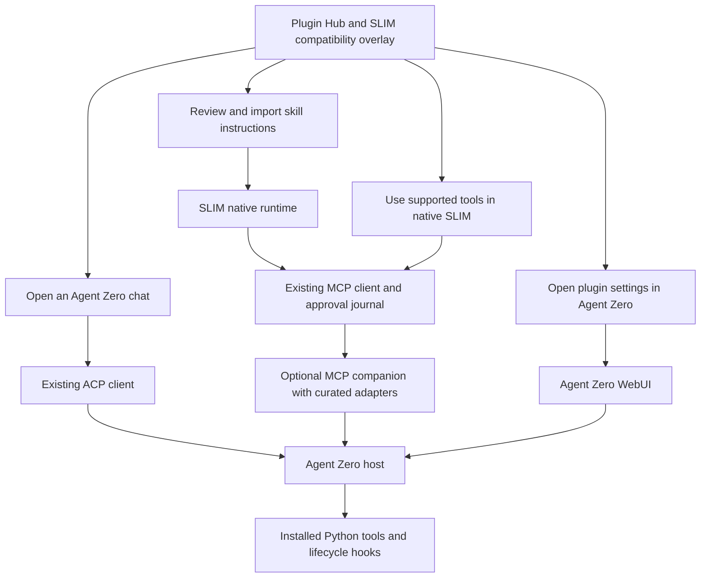

# Agent Zero plugins in A0 SLIM

Research and proposed implementation · 28 October 2026 · Approved in canvas on 2026-10-29 at 02:40 UTC (28 October locally)

## Recommendation

Use an **optional Agent Zero host for existing plugins**, with two ways to reach it: **ACP for whole agent sessions** and **MCP for individually supported plugin tools in native SLIM chats**. Import portable skills separately. Port UI and lifecycle integrations deliberately when they need to run inside SLIM.

This gives us a practical route to reuse plugins without turning the core SLIM installation into a second Python framework. It also lets us provide useful compatibility now while gradually removing the full Agent Zero dependency for selected plugins.

The first implementation should prove **DB Hub status/schema tools through a small MCP companion**, deliver accurate per-capability Hub actions, and preserve ACP as the route for a plugin's Agent Zero behavior. A universal Python compatibility layer is a much larger project and is not the recommended starting point.

**What approval starts:** phases 1–3 below: the compatibility overlay, a bounded companion prototype, and local acceptance using synthetic data. The prototype must earn a supported label before broader rollout. UI ports, automatic plugin installation, background jobs, and production-account activity are later work.

## What the code actually supports today

| Existing piece | Current behavior | Missing piece |
| --- | --- | --- |
| Plugin Hub | Fetches the real catalog; examines pinned repository trees; imports individual Markdown skill files | No executable plugin installation. Its Python/UI file heuristic is not a compatibility test |
| Native SLIM MCP | Streamable HTTP and stdio; tool discovery and grants; exact-call approval; durable unknown-outcome holds | No adapter that exports arbitrary Agent Zero plugin tools |
| Agent Zero MCP preset | Connects to the built-in Agent Zero MCP endpoint | That endpoint exposes `send_message` and `finish_chat`, not the Hub's individual plugin tools |
| ACP | Runs a separate external-agent chat, with streaming and saved remote session IDs | Does not import Python hooks, memory, plugin screens, or tools into a native SLIM chat |
| Skills | Reviews and imports Markdown instructions | Scripts, reference files, commands, and lifecycle hooks are not imported with them |

Two existing statements need correction during implementation: the Hub UI and spec describe the built-in Agent Zero MCP route as individual-tool access. At the inspected Agent Zero revision it is **agent delegation through chat tools**. An explicit companion can add individual plugin tools later. [Agent Zero MCP implementation](https://github.com/agent0ai/agent-zero/blob/ff2a5b9c9c4e490ba38dd7c313e779510bb2071a/helpers/mcp_server.py)

Agent Zero plugins are more than callable Python functions. They can depend on agent context, scoped configuration, secrets, tool interception, history, startup hooks, background services, and browser modules. Even its base `Tool` class writes into Agent Zero history and logs. Hooks can intercept functions and change their arguments or results. [Tool contract](https://github.com/agent0ai/agent-zero/blob/ff2a5b9c9c4e490ba38dd7c313e779510bb2071a/helpers/tool.py), [extension dispatch](https://github.com/agent0ai/agent-zero/blob/ff2a5b9c9c4e490ba38dd7c313e779510bb2071a/helpers/extension.py)

## Architecture

The companion runs with a pinned, working Agent Zero host. It does not import Agent Zero into the Node server. It exposes supported operations as ordinary MCP tools, with explicit schemas and version checks. ACP remains the better path when the work needs Agent Zero's full conversation and lifecycle.

Initially the owner connects an existing, explicitly chosen host or a disposable test host. A managed optional host can come later, after measuring startup time, disk use, memory, upgrade behavior, and cleanup. A full Agent Zero host can be substantial even if SLIM's core stays small.

## Options and tradeoffs

| Option | What it buys | Main limit | Decision |
| --- | --- | --- | --- |
| ACP to Agent Zero | Reuses the remote agent and installed plugin behavior | Changes the chat backend; plugin screens stay remote; native SLIM tools and memory are separate | Keep and make discoverable from Hub |
| Built-in Agent Zero MCP | Lets native SLIM delegate a task to Agent Zero | A natural-language task can cause many remote actions; approving it does not approve each internal operation separately | Label as delegation, not individual plugin access |
| MCP companion on Agent Zero | Native SLIM can call selected plugin operations without a second agent reasoning loop | Requires real Agent Zero context and per-plugin adapters; does not reproduce all hooks/UI | Build the bounded prototype |
| Standalone service or CLI adapter | Selected capabilities work without full Agent Zero | Must replace framework dependencies and validate behavior per plugin | Add where a plugin already has a reusable service/CLI |
| Python compatibility runtime | Could eventually host a larger subset directly | Recreates mutable framework internals, configuration, lifecycle and dependency behavior | Defer; do not claim broad compatibility |
| Native SLIM port | Best fit for SLIM memory and UI integration | Ongoing maintenance of a separate implementation | Use for selected high-value integrations |

ACP is a session protocol, and MCP is a tool protocol. Neither is a general plugin execution environment.

## Representative plugin findings

These are **source assessments**, not successful runtime tests. The inspected catalog contained 221 entries; nine representative plugins were examined. No percentage of the Hub is claimed compatible.

| Plugin and pinned version | Evidence | Proposed route and boundary |
| --- | --- | --- |
| [DB Hub 1.0.0](https://github.com/TerminallyLazy/a0-db-hub/tree/9f3b9926cdd815034b0f9f635c60909107d1f2da) | Nine tools, database drivers, project/agent configuration, memory hooks and workspace UI. `db_schema` uses agent context and secret masking | First companion adapter: `db_status` and `db_schema` on a disposable database. Query/write, memory replacement and the workspace UI remain separate capabilities |
| [You.com Search 1.0.1](https://github.com/brainsparker/a0-youcom-search/tree/2f543aaf28d6db8a7fce29e3e63b2d6a916c5f40) | One tool plus an HTTP helper; uses Agent Zero config, secret lookup, intervention and SearXNG fallback | Second adapter candidate. A standalone MCP port may be small, but must preserve or explicitly omit fallback behavior |
| [Tree Ring Memory 3.4.2](https://github.com/TerminallyLazy/tree-ring-memory-agent-zero/tree/ae4c8c8cab6f30172eb2fb26c27722f38249b615) | CLI-backed tools plus prompt-injection and monologue-end lifecycle hooks | Explicit recall/audit tools are adapter candidates. Automatic native SLIM capture/recall requires a separate lifecycle integration and memory-policy review |
| [OpenUI 0.2.3](https://github.com/TerminallyLazy/a0-openui/tree/47899892f1b8bc76e2b1a92aebe80a082866da76) | Tool uses current answer/log context; custom renderer imports Agent Zero browser modules; streaming hooks and email APIs | Keep the full UI in Agent Zero initially. A SLIM artifact renderer is a distinct port; MCP text results or ACP events do not produce equivalent interactive cards |
| [Selectable Theme 2.0.0](https://github.com/3clyp50/selectable_theme/tree/f8fe897bf6a44c706004b7d833b2c9c8de3a7238) | Mutates Agent Zero DOM/CSS and loads its `/js/api.js` module | Remains an Agent Zero theme. Port selected theme tokens if wanted; no tool bridge can apply its original UI behavior to React |
| [Agent Skills 0.4.0](https://github.com/vanja-emichi/a0_agent_skills/tree/239ffe10531eed627e66d4a789c287318aafb78c) | Markdown skills plus routing/telemetry hooks. The inspected review skill references sibling checklists and Agent Zero tool names | Review/import instructions after identifying missing resources and tool mappings. Importing one file does not port the plugin |
| [Matt Pocock Skills 1.0.0](https://github.com/MarkoSchuetz/a0-mattpocock-skills/tree/545f789fdce5fced518f6dc19eef16a9a64107f2) | Installer fetches a separate upstream repository and copies skills into `/a0/usr/skills`; the wrapper tree contains no `SKILL.md` | Resolve and pin the actual skill source explicitly. A wrapper's Hub commit does not pin dynamically downloaded upstream contents |
| [Realtime Voice 0.1.3](https://github.com/NoHara42/a0-realtime-voice/tree/4c8b9466c70bed8b1164fea31eb0c1dd3de759da) | Browser audio/session UI and delegation into `context.communicate` | Remote voice UI or a dedicated SLIM voice port. A generic MCP tool cannot substitute for the live audio lifecycle |
| [Mech Calendar 1.1.9](https://github.com/twilso24/mech_calendar/tree/4c6678c2f25cfd94d39228c3c57d03fd5151a6b0) | Calendar tool/UI creates Agent Zero scheduler tasks and keeps a handoff ledger | Keep scheduler ownership in Agent Zero. Event CRUD could be adapted later; chat completion must not imply scheduled jobs have stopped |

## Compatibility records and Hub experience

Keep upstream catalog metadata intact. Add a SLIM-owned overlay keyed by **plugin ID + exact source commit + adapter version + Agent Zero version**. Record capabilities separately: tools, skills/resources, lifecycle hooks, UI, and background services.

Each record contains the route, supported operations, prerequisites, limitations, evidence type/date, and tested host versions. Track the installed host revision separately from the catalog pin. A mismatch invalidates the verified state.

Use plain labels such as **Verified tools**, **Skill import available**, **Runs in Agent Zero**, **Port required**, and **Not assessed**. “Runs in Agent Zero” describes a route, not a successful test against the user's host. Distinguish source assessment, fixture test, real plugin execution on synthetic data, and owner-account acceptance.

An entry can offer several actions:

- **Review skills** — show required resources, unsupported tool references, source pins and license.
- **Connect supported tools** — identify host, plugin revision, grants and setup requirements.
- **Use in Agent Zero** — select an ACP connection and create a separate external chat.
- **Open Agent Zero settings** — open the authenticated remote UI at its own origin.
- **View source** — always available, with an explicit unsupported reason where appropriate.

Do not show an Install button until the corresponding installation path exists. Browsing and source assessment never execute install hooks. Prefer opening the original WebUI initially; embedding its arbitrary JavaScript into SLIM would create a separate integration and security problem.

## MCP companion contract

The first companion is a small Agent Zero plugin with a versioned adapter registry. Its source can live under `integrations/agent-zero-tools/` in this project and be packaged separately. Keep the Agent Zero reference checkout read-only.

1. **Explicit exports.** Adapters declare exact plugin commits, canonical implementation paths, operation schemas, effects, dependencies and required context. Use namespaced names such as `a0_db_hub_db_schema`. Do not export every discovered Python method or synthesize trusted schemas solely from prompt examples.
2. **Actual dispatch semantics.** Resolve the intended plugin implementation and enforce Agent Zero tool/profile policy. Preserve required before/after execution hooks, intervention behavior, secret masking and logging. Reject shadowed implementations. Prove that approved arguments remain the executed arguments when hooks can mutate them. Calling `.execute()` directly is not sufficient compatibility.
3. **Bound scope.** Bind the authenticated connection to a specific Agent Zero project/profile and allowed plugin operations. Supply context from that binding, not model-selected project IDs. Serialize operations sharing the same context. SLIM's local `cwd` is not proof of a matching Agent Zero project or plugin configuration.
4. **Stable receipts.** Before dispatch, persist an operation ID, arguments hash, effective adapter/plugin/config revision, target scope and state. A repeated ID returns its existing receipt; changed input is rejected. A crash after dispatch becomes unknown and blocks further affected work until reconciled. Do not promise exactly-once effects from a receipt alone.
5. **Client-owned metadata.** Extend the known companion connection path to send SLIM's persisted call ID and expected compatibility fingerprint in MCP request metadata. The current generic MCP wrapper passes the execution ID locally but does not establish a remote deduplication contract. The model must not choose the operation ID or bypass the version precondition.
6. **Bounded execution.** Start with quick status/schema calls within the current 20-second tool deadline and 64,000-character retained-result limit. Treat transport loss/cancellation as uncertain unless the host confirms completion or cancellation. Long jobs need a later job protocol with inspect/cancel semantics.
7. **Credential custody.** Keep bridge credentials in SLIM's vault and plugin/provider credentials on the Agent Zero host. Return redacted results and public compatibility metadata. The companion is separate from the existing token-in-path Agent Zero MCP preset.
8. **Trust boundary.** A tool allowlist limits what SLIM requests; it does not sandbox installed Python plugins or their hooks. Use a dedicated pinned test host and synthetic data for the prototype. Document the host's filesystem/network authority before real use.

Agent Zero currently dispatches through tool construction, intervention and extension hooks, with policy helpers elsewhere in the framework. The companion must test this combined contract against the pinned host; private framework methods are not a stable public plugin API. [Dispatch implementation](https://github.com/agent0ai/agent-zero/blob/ff2a5b9c9c4e490ba38dd7c313e779510bb2071a/agent.py#L1164), [tool policy](https://github.com/agent0ai/agent-zero/blob/ff2a5b9c9c4e490ba38dd7c313e779510bb2071a/helpers/tool_policy.py)

## Delivery sequence

### Phase 1 — Accurate compatibility and entry points

Replace the file-type-only result with a capability assessment plus curated overlay. Correct MCP delegation wording. Add explicit skill dependency warnings and route-specific actions. Keep existing unassessed entries visible without invented compatibility. Update the approved spec, README and decision log to describe delivered behavior.

**Acceptance:** DB Hub shows a proposed tool route with its exact pin; Selectable Theme shows that native UI requires a port; a skill wrapper without bundled skills is not labeled directly importable. A catalog update invalidates stale evidence.

### Phase 2 — Companion and two DB Hub operations

Implement only bridge identity/health, discovery, operation inspection, `db_status`, and `db_schema`. Install the exact DB Hub release in an isolated Agent Zero 2.14 test host. Configure a disposable local database with a known schema and no production credentials. No database writes or memory-hook activation are needed for this proof.

**Acceptance:** a native SLIM chat stages the real operation, the user can review its exact arguments, and the returned schema matches the fixture. Evidence identifies the actual Python plugin implementation and revisions. Discovery or a mocked response alone does not pass.

**Stop condition:** if these operations require unbounded agent execution or cannot retain policy/context semantics, keep them unsupported and implement a narrower service adapter. Do not quietly replace deterministic tool calls with `send_message` delegation.

### Phase 3 — Recovery and user-visible proof

Prove project/profile isolation, denied tools, changed plugin/config revisions, shadowed tool names, repeated operation IDs, restart after dispatch, two connections to the same host, disable during pending/running work, lost responses and redaction. Exercise the actual packaged companion and DB Hub source, not only copied stubs.

Use ACP for a separate synthetic plugin task once the selected host is authenticated. Prove the remote project/config binding and plugin execution; keep that result separate from the native MCP tool receipt. Existing recorded ACP evidence is initialization-only, with live task acceptance still open.

**Acceptance:** the Hub can truthfully display the supported capability and its tested revisions. Unknown remote effects remain blocked after restart. Disable revokes new calls and reports unresolved work. UI-only plugins remain explicitly unsupported in native SLIM.

Run Node 24 `npm run check`, `npm audit --audit-level=high`, focused companion tests in the framework runtime, packaging verification, and a browser readback. Preserve old chat identities, capability snapshots, native restart regressions, memory namespaces and existing MCP holds. Inspect/stage only owned files and verify the remote ref when committing authorized implementation work.

### Later expansion — Choose by demonstrated value

Add the search adapter next; evaluate a standalone CLI/service route for explicit Tree Ring operations. Add read-only DB queries only after the adapter preserves the plugin's classifier and connection restrictions. Design native memory lifecycle integration and OpenUI rendering independently. Add managed host setup, installation, updates and rollback only after the prototype demonstrates useful coverage.

## Evidence and limits

- Public catalog fetched on **2026-10-29 at 02:32 UTC** (28 October locally): **221 entries**. SHA-256 of the exact downloaded JSON: `544853b287858fea56e01de86c55d3cef824d38a07bc1fb702330404faca765b`. The generated release is mutable; this hash identifies this assessment's snapshot. [Catalog release](https://github.com/agent0ai/a0-plugins/releases/tag/generated-index)
- Agent Zero upstream `main` and the read-only reference checkout both resolved to `ff2a5b9c9c4e490ba38dd7c313e779510bb2071a` during inspection (2.14 baseline). The inspected core files had no local diff. [Pinned source](https://github.com/agent0ai/agent-zero/tree/ff2a5b9c9c4e490ba38dd7c313e779510bb2071a)
- SLIM source inspected: `src/extensions/hub.ts`, `src/extensions/mcp.ts`, `src/extensions/runtime.ts`, `src/acp/client.ts`, `ui/extensions.tsx`, section 8 of `A0-SLIM-SPEC.md`, and `docs/verification/P2.md`. The workspace has concurrent unrelated work; this assessment adds its own plan artifacts only.
- This investigation fetched public metadata/source and traced contracts. It did not install plugins, send an agent task, use a provider account, modify Agent Zero, or prove runtime compatibility. Those results belong to the acceptance phases above.

## Review decision

The proposed starting point is **an optional Agent Zero host, accurate Hub routes, and the two-operation DB Hub MCP proof**. Approving this plan starts phases 1–3; the later expansion list remains a roadmap. Comments can change the first target plugin or prioritize a standalone port if avoiding a full Agent Zero host is the stronger product requirement.
