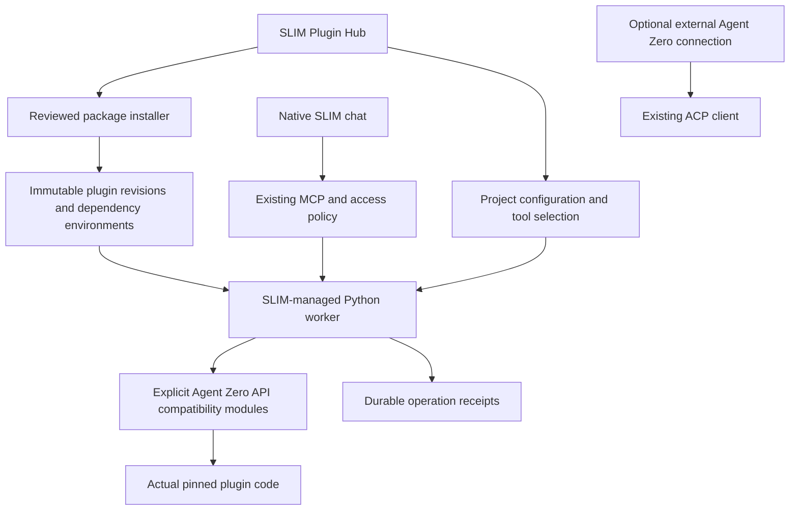

# Agent Zero Hub plugins without an Agent Zero installation

29 October 2026 · Direction approved in canvas

## Approved requirement

**A user must be able to install and use supported Hub plugins directly in SLIM without installing Agent Zero.** The user approved a smaller, SLIM-managed compatibility worker instead of requiring or bundling the full Agent Zero runtime. ACP remains optional for people who already use Agent Zero.

This supersedes the external-host default in the first draft. The existing DB Hub companion remains available, but its full-framework dependency is not the native product path.

## Architecture

Keep the Node/libfx runtime as SLIM's agent. Add an optional Python worker, managed by SLIM, that executes pinned plugin implementations through explicit compatibility modules. Standard MCP carries native tool calls and existing access decisions. SLIM owns project configuration, credentials, lifecycle and receipts.

The worker is not a second agent loop. No Agent Zero server, account, model configuration or Docker daemon is required for the first native path. Python and plugin dependencies are explicit optional runtime downloads, isolated from the core npm dependency graph. Local subprocess isolation is not an OS security sandbox; setup must accurately state the process's host authority.

## Why compatibility code is needed

The existing companion imports `agent.AgentContext`, which transitively imports the full framework and provider stack. Agent Zero's base `Tool` also depends on that framework for logging, history, interception and intervention. Merely copying those files would recreate the dependency we are removing.

DB Hub's pinned status/schema tools use `helpers.tool`, scoped plugin configuration, project identity, intervention and secret masking. These are a bounded first compatibility surface. Implement the required contracts explicitly, execute actual pinned plugin sources, and reject unsupported imports or behaviors. Do not silently substitute empty hooks or claim full Agent Zero semantics.

The boundary must be versioned: plugin source revision + compatibility API revision + adapter revision + dependency lock + effective project configuration. A changed fingerprint requires rediscovery and the existing access policy. Original source and adapted/ported functionality must be distinguished in compatibility records.

## First implementation

### 1. Independent worker and actual plugin proof

Build the worker and minimal required APIs for DB Hub 1.0.0 at `9f3b9926cdd815034b0f9f635c60909107d1f2da`. Begin with status/schema for an existing local SQLite database through its SQLAlchemy driver. Keep memory replacement, database writes, unrelated drivers and automatic hooks disabled and explicitly unsupported.

Run the original plugin tool implementations in a clean environment containing SLIM's worker and pinned dependencies, with no Agent Zero installation or source checkout on the import path. Preserve project scope, tool argument checks, cancellation reporting, result bounds and secret redaction. Retain client-owned operation IDs, durable journal reuse and unknown-effect holds.

**Acceptance:** a native SLIM chat calls the real pinned tool, returns the known synthetic schema, and survives restart without duplicate dispatch. A test asserts that Agent Zero is absent. Existing full-host companion evidence does not count as this proof.

### 2. Install, configure and use from the Hub

Add a small owned package/runtime manager and a native plugin setup panel. Supported entries offer installation into SLIM's private data directory, review of exact revisions and optional runtime downloads, project-specific configuration, capability selection and disable/remove actions. Users do not assemble Python or Docker commands.

Download only reviewed immutable source/dependency artifacts. Validate checksums, manifests, plugin identity, archive paths and size bounds before extraction or execution. Stage atomically and retain the previous revision. No arbitrary repository install hook executes merely because a catalog entry exists. Dynamic secondary downloads require their own pinned recipe; otherwise mark the plugin unsupported.

Keep credentials in the vault, out of source trees, command arguments and public metadata. Bind workers to owner-selected project configurations rather than model-supplied filesystem/project identities. Install state and tool readiness are separate. Removing a connection must not erase unresolved operation evidence or plugin data silently.

**Acceptance:** Hub → install runtime/plugin → configure synthetic SQLite → enable → native chat → actual result works from a fresh SLIM installation. Restart, failed download, changed pin, duplicate setup and disable with unresolved work have meaningful states. The packed npm artifact includes the worker/recipes and operates without this repository checkout.

### 3. Generalize by concrete plugin families

Keep an explicit adapter registry. Each adapter declares supported operations, required compatibility modules, schemas, dependencies, effects and tested revisions. Add You.com Search as the next tool-family candidate after verifying its current source and provider/fallback behavior. Evaluate Tree Ring's explicit recall/audit CLI separately. Portable skill resources can be supported independently of executable plugins.

Expand shared compatibility APIs only when real plugin behavior requires them. Plugins that depend on Agent Zero's full agent model, private internals or arbitrary lifecycle hooks receive a clear capability reason rather than a false ready state. The implementation should remain extensible beyond the first plugin, but the first release must identify its bounded executable coverage.

**Acceptance:** each newly advertised capability runs actual pinned plugin code in the independent worker, with its own source and runtime receipts. A source-tree heuristic or mocked output is insufficient. Real-provider acceptance remains separate from synthetic transport tests.

### 4. UI and lifecycle capabilities

Provide SLIM-native configuration forms for supported adapters. Original Agent Zero browser code imports its own DOM/modules; do not inject it into SLIM's origin. OpenUI needs a deliberate artifact/rendering contract; automatic Tree Ring capture/recall needs native memory-policy/lifecycle integration; scheduling and voice need explicit job/session ownership. These are independent capabilities and must not block ordinary supported tools.

Add narrowly defined lifecycle events through the runtime adapter when needed, preserving per-turn capability snapshots and atomic memory receipts. Do not emulate the entire mutable Agent Zero framework speculatively. Retain optional ACP for users who choose full Agent Zero behavior, without making it a dependency of native plugin use.

## Lifecycle and recovery

Record setup state, installation identity, exact source/dependencies, project configuration and operation receipts durably. Serialize conflicting mutations. A reused operation ID returns its receipt; changed input is rejected. A crash after dispatch remains unknown until reconciled, with holds applying across aliases. Disabling prevents new calls and reports running/uncertain work. No exactly-once side-effect guarantee is implied.

Updates use a newly reviewed recipe and fresh environment, with activation after checks. Preserve configuration/data and previous artifacts. Source rollback does not undo dependency hooks or data migrations; unsupported migrations must not run under a claim of automatic rollback.

## Verification and ownership

Use Node 24, `npm run check`, `npm audit --audit-level=high`, focused Python/transport tests, the packed CLI and browser readback. Test real plugin code, no-Agent-Zero independence, project isolation, redaction, changed pins, altered schemas, unknown outcomes, reconnect and package distribution. Preserve native restart/file-evidence tests, old chat identities, embedding namespaces and MCP holds.

Keep the reference Agent Zero checkout read-only and preserve `docs/original/A0-SLIM-SPEC.md`. Update the working spec, README, decisions and acceptance records to describe the actual delivered capability. Isolate implementation from unrelated branding edits. Push only owned changes and verify the remote ref.

## Existing evidence and immediate fix

The earlier merged companion at `2fd6bfa` proves real DB Hub status/schema on a full Agent Zero 2.14 host. Recorded owner-host ACP acceptance and browser checks also exist. They remain useful regression context and do not prove this new independent runtime.

The reported Memory sidebar layout defect is fixed separately in `21a8aba`, pushed to main. The compact section now stacks the description and permission controls in a single grid column. Node 24 checks passed 196 tests, typecheck and build; audit reported zero vulnerabilities. Browser readback verified the narrow inspector and full Memory view without horizontal overflow. Unrelated local branding edits were preserved.

## Sources

- [Existing prototype plan](PLUGIN-HUB-COMPATIBILITY.plan.md) and [recorded companion/ACP acceptance](../verification/PLUGIN-COMPANION.md).
- SLIM: `integrations/agent-zero-tools/host.py`, `src/extensions/hub.ts`, `compatibility.ts`, `mcp.ts`, `src/acp/client.ts`.
- [Agent Zero Tool contract](https://github.com/agent0ai/agent-zero/blob/ff2a5b9c9c4e490ba38dd7c313e779510bb2071a/helpers/tool.py) and [Agent dependencies](https://github.com/agent0ai/agent-zero/blob/ff2a5b9c9c4e490ba38dd7c313e779510bb2071a/agent.py).
- [DB Hub pinned tools and helpers](https://github.com/TerminallyLazy/a0-db-hub/tree/9f3b9926cdd815034b0f9f635c60909107d1f2da).

Canvas feedback: “We want to avoid REQUIRING the user to have Agent Zero installed.” Response recommended a smaller SLIM-managed compatibility worker; user replied “your recommendation is approved” at 2026-10-29 07:19 UTC (03:19 locally).
